# DC Motor Speed Control and State Estimation

PID and LQR-with-integral-action controllers for a DC motor, a Kalman filter (and LQG loop) that works from a single noisy speed sensor, and the same Kalman machinery applied to a daily physiological time series. Everything is simulation (Python, no hardware).

The goal is a fair comparison with checked numbers, not just plots: both controllers are tuned against the *same* cost and constraints, the Kalman filter is tested for statistical consistency, and the limits of each result are stated.

## Results at a glance

| | Result |
|---|---|
| **PID vs LQR** (100 rad/s step, same cost and constraints) | LQR: 0 % overshoot, 154 ms settling, 0.46 rad/s load dip. PID: 4.9 % overshoot, 202 ms settling, 1.79 rad/s load dip, but faster rise (51 vs 83 ms). |
| **Robustness** (J ×0.5/×2, R ±20 %, K ±20 %) | PID overshoot grows to 15.8 % (J ×2) and 11.6 % (K ×0.8). LQR stays at 0 % with settling between 145 and 162 ms. |
| **Saturation** (180 rad/s step, 12 V limit) | Without anti-windup the PID overshoots 17.9 %; with back-calculation 3.7 %; LQR 0 %. |
| **Kalman filter, speed only** | Speed error 2.00 → 0.175 rad/s RMS (11×). The unmeasured armature current is recovered to 0.030 A RMS (true current std 0.44 A). |
| **Filter consistency** | Mean NIS 0.995 (95 % band 0.980–1.020), 95.1 % of NIS values inside the χ²(1) 95 % interval, innovation autocorrelation inside the white-noise band at all 30 lags. |
| **LQG vs PID under noise** (20 seeds) | Same tracking error (0.283 vs 0.276 rad/s) and load dip, with **3.6× less voltage activity** (0.17 vs 0.61 V std). |
| **Load torque as a state** | Estimated 0.0201 N·m vs true 0.020. Without the state, the current estimate is biased by −0.23 A after the load step; with it, +0.001 A. |
| **Weekly-seasonal Kalman smoother** (synthetic demo) | Baseline error 0.027 vs 0.120 for raw data (4.4×); weekday effects recovered within 0.03 log units. |

> **Data status:** the physiological-series section (Part C) currently runs on a **synthetic dataset with known ground truth**. It has *not* been run on a real WHOOP export. See [Using your own WHOOP data](#part-c-kalman-smoothing-of-a-daily-physiological-series).

## Repository layout

```
src/dcmotor/
  plant.py      motor model (transfer function, state space, exact ZOH discretisation)
  design.py     PID (filtered derivative, anti-windup), LQR + integral, simulator, metrics, tuning
  kalman.py     online Kalman filter, motor filters (2- and 3-state), batch filter, RTS smoother, ML fit
  whoop.py      WHOOP CSV loader and synthetic stand-in
  style.py      plotting style
scripts/        run_part_a.py  run_part_b.py  run_whoop.py
notebooks/      walkthrough.ipynb   (executed, outputs included)
tests/          test_core.py        (7 tests)
figures/ results/                   (generated; metrics as JSON)
data/           sample_whoop_format_SYNTHETIC.csv
```

## Quick start

```bash
pip install -r requirements.txt
python scripts/run_part_a.py      # ~10 s  -> figures/a*.png, results/part_a_metrics.json
python scripts/run_part_b.py      # ~20 s  -> figures/b*.png, results/part_b_metrics.json
python scripts/run_whoop.py       # ~3 s   -> synthetic demo
python -m pytest -q tests         # 7 tests
jupyter notebook notebooks/walkthrough.ipynb
```

## The plant

Armature-controlled DC motor, state *x* = [*i*, ω], input *V*, disturbance *T*<sub>load</sub>, measured output ω:

```
L di/dt = V − R i − Ke ω          J dω/dt = Kt i − b ω − T_load
G(s) = Kt / ((J s + b)(L s + R) + Kt Ke)
```

R = 1 Ω, L = 5 mH, Kt = Ke = 0.05, J = 2·10⁻⁴ kg·m², b = 10⁻⁴, 12 V supply. Poles at −186.6 and −13.9 rad/s (5.4 ms and 71.8 ms time constants), DC gain 19.2 rad/s/V, no-load speed 231 rad/s at 12 V. The open loop is stable, so feedback is for accuracy, speed and disturbance rejection.

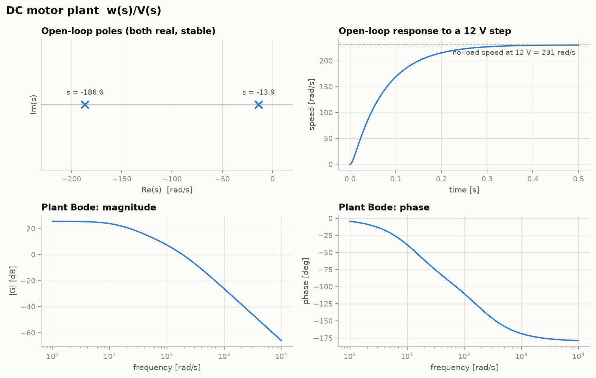

## Part A: PID vs LQR with integral action

**Setup.** Task: 100 rad/s step, then a 0.02 N·m load step at 1 s. Controller runs at 1 kHz with exact zero-order-hold plant discretisation and a 12 V actuator limit.

* **PID:** derivative on the measurement through a first-order filter (N = 500 rad/s), back-calculation anti-windup. Gains: Kp = 0.119, Ki = 2.11, Kd = 5.2·10⁻⁴.
* **LQR + integral:** full-state feedback on [*i*, ω, *z*] with ż = *r* − ω, anti-windup by back-calculation on *z*. Gains: Kx = [1.49 (i), 2.09 (ω)], Kz = −49.3.
* **Fair tuning:** both are tuned by Nelder–Mead on one shared cost (ITAE of the step + load dip + recovery time) with the same penalties: overshoot ≤ 5 %, peak command ≤ 12 V, plus phase margin ≥ 60° for the PID.

| 100 rad/s step, noise-free | PID | LQR + integral |
|---|---|---|
| Overshoot | 4.9 % | 0 % |
| 10–90 % rise | 51 ms | 83 ms |
| 2 % settling | 202 ms | 154 ms |
| Load dip (0.02 N·m) | 1.79 rad/s | 0.46 rad/s |
| Recovery to within 1 rad/s | 103 ms | never leaves the band |
| Steady-state error | 0 | 0 |
| Phase margin (continuous time) | 81° at 31 rad/s | 74° at 358 rad/s |
| Phase margin after ½-sample ZOH delay | ≈ 80° | ≈ 63° |
| Gain margin | ∞ | ∞ |

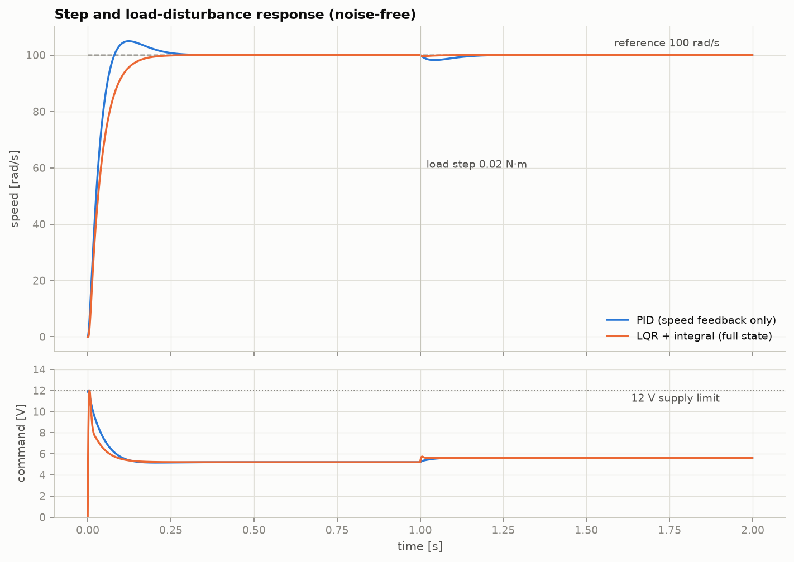
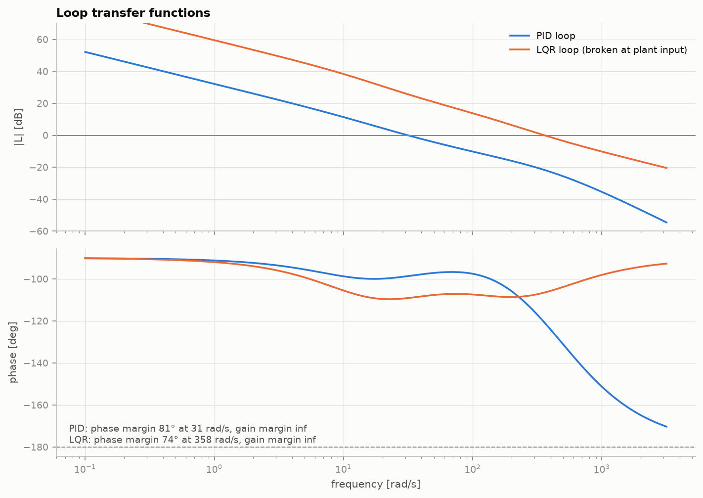

**Reading the result.** The PID's overshoot and peak voltage sit on their constraints, which is what the optimiser does. LQR rejects the load step about 4× better because it feeds back the armature *current*, which reacts to the torque before the speed does. **This is not an equal-information comparison:** the PID sees only speed, the LQR sees the full state. Part B removes that advantage by estimating the current.

**Saturation.** With a 180 rad/s step the supply limit is active for ~0.1 s. Integrator windup costs the PID 17.9 % overshoot; back-calculation brings it to 3.7 %.

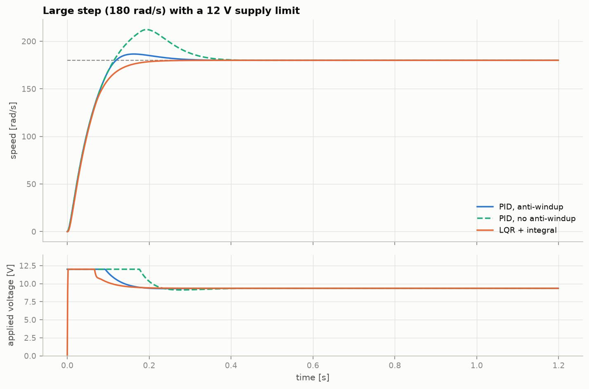

**Plant mismatch.** Controllers designed on the nominal plant, run on six perturbed plants:

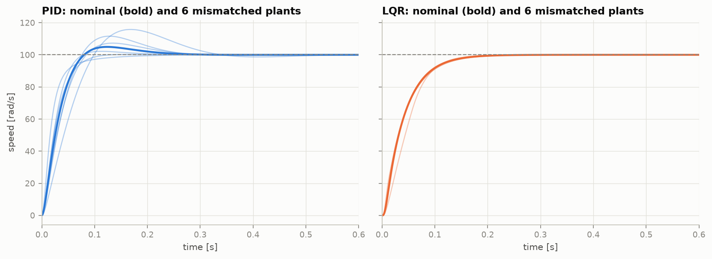

| Overshoot [%] | J ×0.5 | J ×2 | R ×0.8 | R ×1.2 | K ×0.8 | K ×1.2 |
|---|---|---|---|---|---|---|
| PID | 0.0 | **15.8** | 2.2 | 7.3 | **11.6** | 0.3 |
| LQR | 0.0 | 0.0 | 0.0 | 0.0 | 0.0 | 0.0 |

The LQR's high speed- and current-feedback gains make it insensitive to these parameter errors (settling stays between 145 and 162 ms), while the PID breaks its 5 % overshoot spec in three of six cases. This needs the current measurement or an estimate of it.

## Part B: Kalman filter and LQG

**Setup.** Only speed is measured, with white noise σ = 2 rad/s. The simulator also injects white per-sample noise on the voltage (0.1 V) and the load torque (0.005 N·m). The filter is given exactly these values, so any inconsistency would be a bug rather than model mismatch. Process covariance is built as Q = [B<sub>d</sub> B<sub>d,T</sub>] diag(σ<sub>v</sub>², σ<sub>T</sub>²) [·]ᵀ, with a Joseph-form covariance update.

**Estimation.** The filter reduces speed error from 2.00 to 0.175 rad/s RMS and reconstructs the never-measured armature current to 0.030 A RMS.

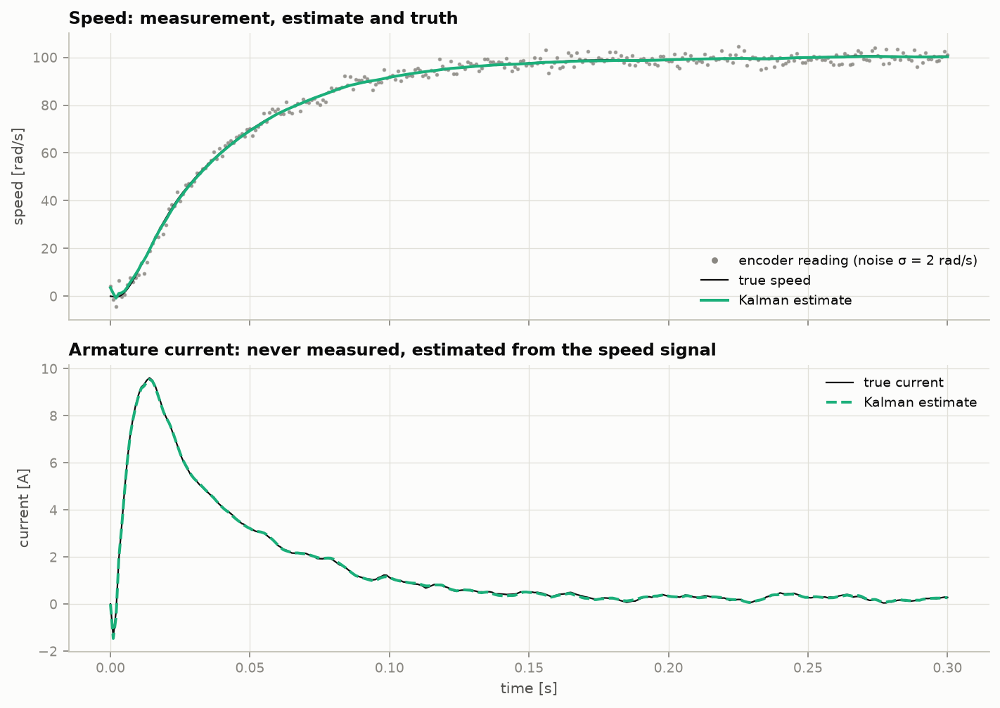

**Consistency.** On a 20 s run (19 000 samples after burn-in) with no load step:

| Check | Observed | Expected |
|---|---|---|
| Mean NIS | 0.995 | 1 ± 0.020 (95 %) |
| Fraction of NIS inside χ²(1) 95 % interval | 95.1 % | 95 % |
| Innovation autocorrelation, lags 1–30 | all inside ±0.0142 (largest touches the edge) | white |

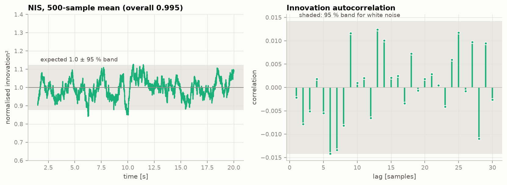

**LQG vs PID under noise** (20 seeds, steady-state window 0.5–1.0 s):

| | PID (noisy speed) | LQG (LQR + Kalman) |
|---|---|---|
| Speed error RMS [rad/s] | 0.276 | 0.283 |
| Voltage std [V] | 0.610 | **0.170** |
| Load dip [rad/s] | 2.11 | 2.17 |

Tracking and load rejection are statistically indistinguishable (process noise dominates the speed error). The benefit is **3.6× less actuator activity** for the same performance, because the controller acts on the filtered estimate rather than raw encoder noise. It is not better tracking.

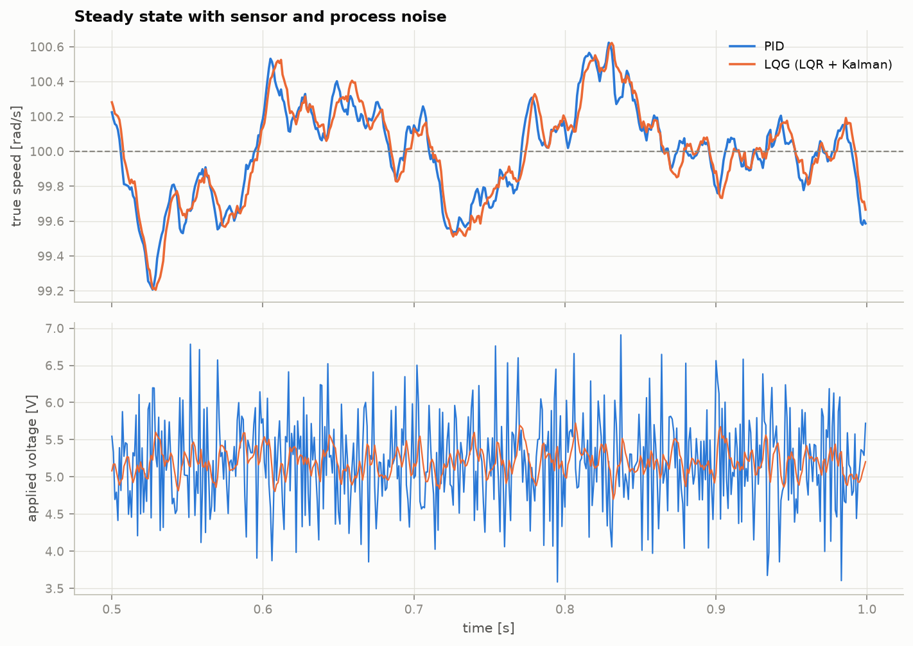

**Unknown load torque as a state.** Adding a random-walk torque state lets the filter infer the load from speed alone (0.0201 N·m estimated vs 0.020 true). Without that state the 2-state filter's current estimate is biased by −0.23 A after the load step; with it the bias is +0.001 A. The random-walk intensity σ<sub>dw</sub> trades noise against speed (30 seeds):

| σ<sub>dw</sub> [N·m per sample] | Torque-estimate noise (std) | Time to 90 % of the step |
|---|---|---|
| 0.0005 | 1.7 mN·m | 81 ms |
| 0.002 (used) | 4.5 mN·m | 35 ms |
| 0.008 | 12.6 mN·m | 13 ms |

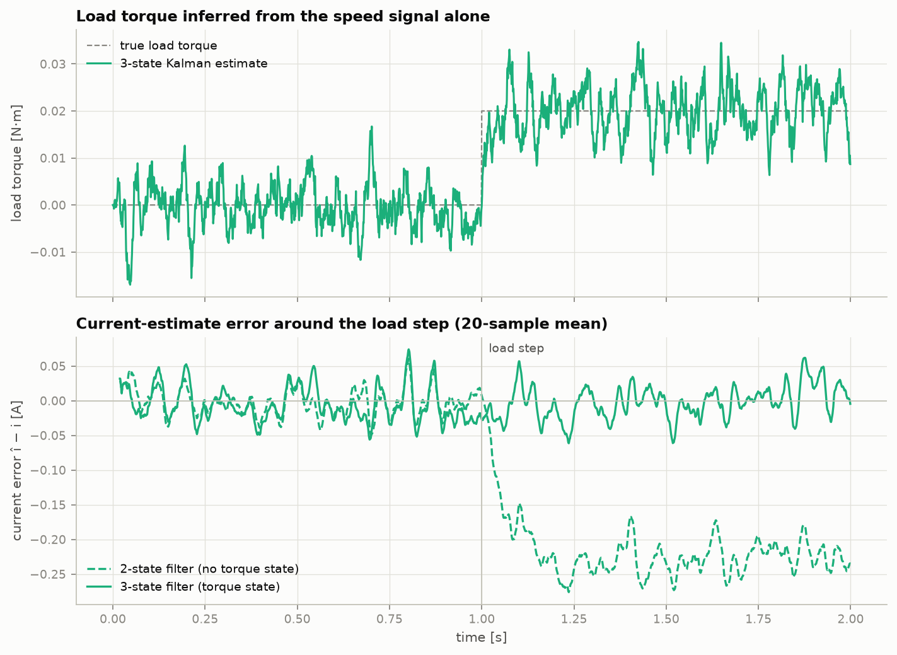

## Part C: Kalman smoothing of a daily physiological series

The same linear-Gaussian machinery, now for a slow daily signal. Model: *y*<sub>t</sub> = μ<sub>t</sub> + *s*<sub>t</sub> + ε<sub>t</sub>, a random-walk baseline μ plus a weekly seasonal *s* (dummy form, 6 states). For HRV, *y* = ln(HRV). The three variances are fitted by **maximum likelihood** on the Kalman prediction-error decomposition, missing days are handled by skipping the measurement update, and a Rauch–Tung–Striebel smoother gives baseline and weekday effects.

**Synthetic demo** (140 days, 6 missing, known ground truth; baseline drifts, Saturday dip of −13 %):

| Check | Result |
|---|---|
| Baseline error, smoothed vs raw observations | 0.027 vs 0.120 log units (4.4×) |
| Weekday effects, max abs error | 0.030 log units (Saturday: −15.1 % estimated vs −13.1 % true) |
| Estimated observation noise | 0.082 (true 0.09) |
| Standardised innovations | std 1.00, lag-1 autocorrelation −0.05, mean −0.18 (slightly negative, about 2 standard errors) |

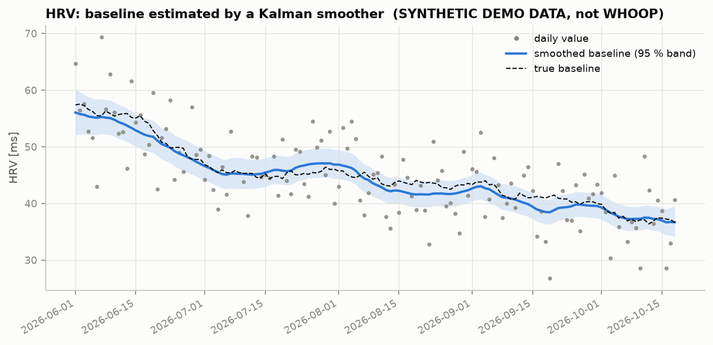
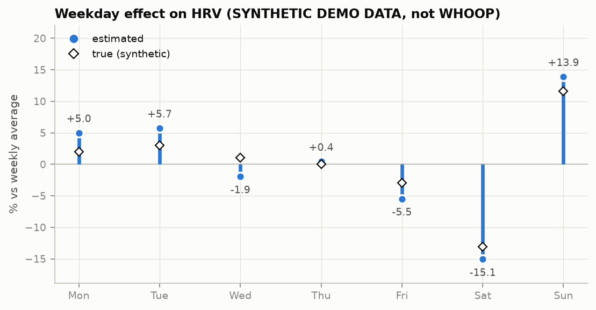

### Using your own WHOOP data

```bash
python scripts/run_whoop.py --csv data/whoop.csv --metric hrv        # also: recovery | rhr
python scripts/run_whoop.py --csv data/whoop.csv --metric recovery --date-col "Cycle start time" --value-col "Recovery score %"
```

The loader expects the WHOOP data-export style (`physiological_cycles.csv`): `Cycle start time`, `Recovery score %`, `Resting heart rate (bpm)`, `Heart rate variability (ms)`. Columns are matched case-insensitively by keyword; use `--date-col` / `--value-col` if your export uses other names. At least four weeks of data are required. `data/whoop*.csv` is git-ignored because it is personal health data. `data/sample_whoop_format_SYNTHETIC.csv` shows the expected format and is synthetic.

## Limitations

* The motor is a **linear model with voltage saturation**. No Coulomb friction, encoder quantisation, PWM, current limit or computation delay; the controller runs at 1 kHz with zero delay. Real hardware would need those modelled before trusting the margins.
* Margins are computed on the continuous-time loop; the sampled-data correction shown is a first-order (half-sample delay) estimate.
* Nelder–Mead finds local minima. Both controllers are tuned to the same cost, but a different cost would shift the PID/LQR trade-offs.
* The filter is consistent because it was given the true noise levels. With wrong covariances it would still run; the NIS test is what would reveal it.
* The weekly model assumes a fixed seasonal pattern (the ML fit drives the seasonal variance to ~0 on the synthetic data, which is correct there but need not be on real data).
* Part C results are from synthetic data only.
